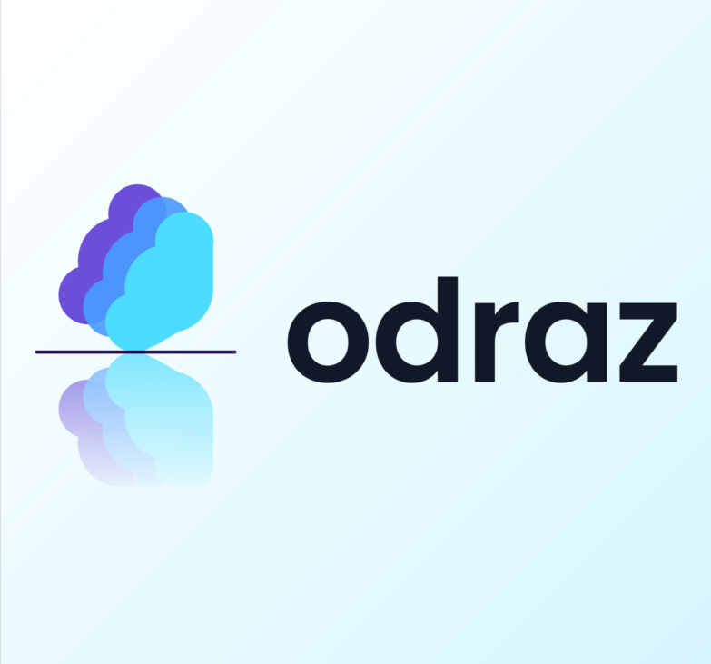

<br/><br/><p align="center">
  <picture>
    <source media="(prefers-color-scheme: dark)" srcset="assets/branding/odraz_lockup_dark.png">
    
  </picture>
</p>
<h3 align="center">
View your photos and sync them to your own storage
</h3>

> **odraz is a fork of [Pho](https://github.com/fregie/pho) by fregie.**
> The goal: keep everything the open-source edition of Pho already does, and add
> **S3-compatible storage** as a synchronization target.

## Download

Android APKs are on the [Releases page](https://github.com/0xWailing/odraz/releases). Most phones need
the `arm64-v8a` file. The builds are signed with a debug key, so Android will ask you to allow
installing from your browser. The app installs under its own ID (`xyz.whaling.odraz`), next to
Pho if you have it.

## About this fork

Pho is a simple, serverless app that replaces the phone's native gallery and syncs photos to
network storage without any database or server-side component. odraz keeps that design and
all existing features unchanged.

What this fork adds:

- **S3-compatible storage as a sync option** (AWS S3, MinIO, Cloudflare R2, Backblaze B2, Ceph, etc.)

S3 support is implemented (upstream Pho has no S3 backend) and has been tested with
**Backblaze B2** and a local S3-compatible server. It has **not yet been verified against AWS S3**. See the
[roadmap](#roadmap) for what is still planned.

## Features

Inherited from Pho:

* Local photo browsing
* Cloud photo browsing
* Incremental photo synchronization to the cloud
* Background periodic synchronization
* Image zoom, video upload and browsing
* No database, no server-side
* Cloud directory structure organized by date

## Supported storage

| Backend | Status |
|---|---|
| Samba (SMB) | Supported (from Pho) |
| WebDAV | Supported (from Pho) |
| NFS | Supported (from Pho) |
| S3-compatible | Supported (this fork), see [S3 setup](#s3-setup) |

Android is the primary target. The iOS, Linux, macOS and Windows code is inherited from Pho but is not maintained or tested in this fork.

## S3 setup

odraz syncs to any S3-compatible service (AWS S3, Backblaze B2, MinIO, Cloudflare R2, ...).

1. **Create the bucket yourself first, and keep it empty.** odraz never creates buckets, and it
   expects a bucket it owns: it does not read buckets already filled by other apps or by the Pro
   edition of Pho.
2. Create an access key with read, write, list and delete permission on that bucket.
3. In the app, open the storage settings, choose **S3** and fill in:

| Field | Notes |
|---|---|
| Endpoint | Host and optional port, for example `s3.us-west-004.backblazeb2.com` or `s3.amazonaws.com`. A leading `https://` or `http://` is accepted and overrides the HTTPS switch. |
| Region | Optional for most providers. |
| Bucket | The bucket you created. It must already exist. |
| Access key / Secret key | The key pair from step 2. |
| Root prefix | Optional folder-like prefix to keep odraz's files under. |
| Use HTTPS (TLS) | On by default. Certificates are always verified; turn it off only for a plain-HTTP server such as a local test instance. Self-signed HTTPS certificates are not supported. |
| Path-style addressing | Off for AWS S3, on for Backblaze B2, MinIO and most other services. It follows the endpoint until you change it yourself. |

4. Press **Test storage** and then **Save**. Setup fails with a clear message if the credentials are wrong
   or the bucket does not exist.

Objects use the same layout as the other backends (`YYYY/MM/DD/<file>` plus a `.thumbnail/` tree).
Each upload also records the photo's original time as object metadata (`taken-at`), which stays
available if you download the files outside the app.

> **Credentials are stored unencrypted** in the app's preferences for now (like the SMB and WebDAV
> passwords). Encrypting them is on the [roadmap](#roadmap).

## Screenshots

<p align="left">


</p>

## Roadmap

- [x] SMB, WebDAV and NFS sync (inherited from Pho)
- [x] S3-compatible drive backend in the Go server (`server/drive/s3`)
- [x] S3 settings in the app (endpoint, region, bucket, credentials, path-style addressing)
  - The bucket must be created by you beforehand and should be empty; odraz does not create buckets
  - S3 credentials are stored unencrypted in the app's preferences at first
- [ ] Encrypt stored credentials (S3 and other drives) in the app
- [x] Tests against a containerized S3-compatible server (RustFS) in `test/docker-compose.yml`
- [x] Keep the existing date-based object layout and `.thumbnail/` prefix on S3
- [x] Verify against Backblaze B2
- [ ] Verify against AWS S3
- [ ] Prefix-based listing for S3 (`LIST` with prefix/delimiter) with result caching, instead of re-walking the whole date tree on every call
- [ ] Disk cache for cloud thumbnails, to cut repeat S3 requests while scrolling
- [ ] Generate thumbnails on demand for photos that were added to the bucket by other tools
- [ ] Encryption settings UI (enable, AES-256-GCM, password) for the existing server-side encryption
- [ ] Replace the iterative-MD5 key derivation with PBKDF2 or Argon2, keeping old encrypted files readable

## Build

### Requirements
- Flutter: 3.41.4 (stable), Dart: 3.11.1
- Go: 1.25 (toolchain go1.25.4)
- JDK: 17 (Gradle 8.14 does not run on JDK 25, so do not point it at a newer JDK)
- Android SDK: compileSdk 36
- Android NDK: 28.2.13676358, used to build the embedded Go server (gomobile bind)
- gomobile: `go install golang.org/x/mobile/cmd/gomobile@<version in go.mod>` (and `gobind`)
- protoc + plugins: protoc-gen-go@v1.27.1, protoc-gen-go-grpc@v1.1.0, protoc_plugin@21.1.2 (Dart)

### Steps
```bash
# 1. Generate protobuf code (Go + Dart stubs)
make prebuild      # install protoc plugins
make protobuf

# 2. Build the embedded Go server
make server-aar     # Android: android/app/libs/server.aar (needs gomobile)
make server-ios     # iOS: ios/Frameworks/RUN.xcframework
make server-linux   # Linux: linux/lib/run.so
make server-windows # Windows: windows/lib/run.dll

# 3. Build the Flutter app
make apk           # Android APK
make ipa           # iOS IPA

# 4. Run tests (Docker is required for the SMB/WebDAV/NFS test containers)
make test
# S3 tests only: docker compose -f test/docker-compose.yml up -d s3, then
# go test ./server/drive/ -run 'TestDriveSuite/(TestAllDrives/S3|TestS3_)'
```

> The Android Gradle build rebuilds `android/app/libs/server.aar` by itself whenever the Go
> sources change (task `buildGoServer`, so `flutter run`, `make apk` and Android Studio all
> pick up Go changes). It needs `go` and `gomobile`; it looks in your `PATH` and in
> `~/go/bin`. If they are missing it warns and keeps the existing `server.aar`. You can still
> build it by hand with `make server-aar`.

### Android Studio
1. Install the **Flutter** and **Dart** plugins, then set *Settings > Languages & Frameworks >
   Flutter > Flutter SDK path* to the folder where you cloned Flutter.
2. Use **one** Android SDK for both Studio and Flutter (Studio's default is `~/Android/Sdk`):
   `flutter config --android-sdk ~/Android/Sdk`. Install platform 36, build-tools 36 and NDK
   28.2.13676358 there with the SDK Manager.
3. Set *Settings > Build, Execution, Deployment > Build Tools > Gradle > Gradle JDK* to a JDK 17.
   The JDK bundled with newer Android Studio versions is too new for this project's Gradle.
4. Pick a device or emulator and press Run. Hot reload works as usual.

## File storage logic

Files are stored using the date as the directory structure and the source file name as the
filename. A `.thumbnail` directory is created in the root directory to hold generated
thumbnails, mirroring the structure of the source files.

You can access and use your backed-up photos in any other way at any time, without depending on
this application.

```bash
├── 2022
│   ├── 07
│   │   ├── 02
│   │   │   ├── 20220702_100940.JPG
│   │   │   ├── 20220702_111416.JPG
│   │   │   └── 20220702_111508.JPG
│   │   └── 03
│   │       ├── 20220703_101923.DNG
│   │       ├── 20220703_112336.DNG
│   │       └── 20220703_112338.DNG
├── 2023
│   └── 01
│       └── 03
│           ├── 20230103_112348.JPG
│           ├── 20230103_124634.JPG
│           └── 20230103_124918.DNG
└── .thumbnail
     └── 2022
         └── 07
             ├── 02
             │   ├── 20220702_100940.JPG
             │   ├── 20220702_111416.JPG
             │   └── 20220702_111508.JPG
             └── 03
                 ├── 20220703_101923.DNG
                 ├── 20220703_112336.DNG
                 └── 20220703_112338.DNG
```

## Differences from upstream Pho

This fork is based on the open-source edition of Pho. Features that upstream ships only in its
Pro edition (parallel upload tuning, filters, Baidu Netdisk, etc.) are not part of this repository.

AES encryption is a partial case: the server-side engine (AES-256-GCM and legacy AES-128-CFB in
`server/imgmanager/encrypt.go`) and the client plumbing are present, but the settings UI to turn it
on was removed upstream. Restoring that UI is on the [roadmap](#roadmap).

## Contributing

See [CONTRIBUTING.md](CONTRIBUTING.md). Issues and pull requests are welcome, especially for the S3
backend.

## License and credits

Released under the license in [LICENSE](LICENSE). odraz is derived from
[fregie/pho](https://github.com/fregie/pho); all credit for the original application goes to its
author and contributors.
